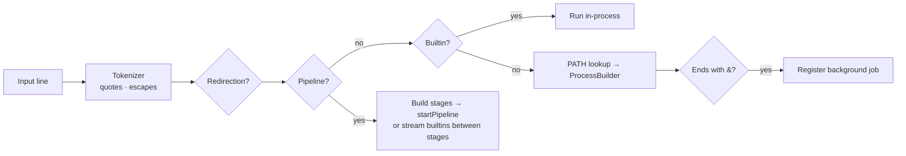

<div align="center">

# 🐚 jsh: a POSIX-style shell in Java

**A working Unix shell written from scratch in Java: builtins, `PATH` lookup, quoting, redirection, pipelines, background jobs and tab completion.**

[](https://app.codecrafters.io/users/kartikeya2006jay?r=2qF)

[](https://openjdk.org/)
[](pom.xml)
[](https://github.com/jline/jline3)
[](https://app.codecrafters.io/courses/shell/overview)

</div>

---

## Why

A shell is the program developers use most and understand least. Building one by hand answers questions like *how does `PATH` lookup work?*, *what does `2>>` really do?* and *how does `a | b | c` wire processes together?*
This is my solution to the CodeCrafters **"Build Your Own Shell"** challenge, written in a single `Main.java` file of about 600 lines.

## What it supports

| Area | Details |
|---|---|
| **REPL** | Prompt, line editing and history through JLine |
| **Builtins** | `echo`, `exit`, `type`, `pwd`, `cd` (including `~` and relative paths) and `jobs` |
| **External programs** | Looked up through `$PATH` and started with `ProcessBuilder`. `type` reports where a command resolves |
| **Quoting** | Single quotes, double quotes and backslash escapes, including `\"` and `\\` inside double quotes |
| **Redirection** | `>` `1>` `>>` `1>>` for stdout and `2>` `2>>` for stderr, with append and truncate modes |
| **Pipelines** | Multi-stage `a | b | c`. External-only pipelines use `ProcessBuilder.startPipeline`, and builtins can be mixed into a pipe |
| **Job control** | Background jobs with `&`, a `jobs` table with `+` and `-` markers, and reaping of finished jobs |
| **Tab completion** | Completes builtins and executables on `PATH` |

## How a line is executed



## Run it

**Prerequisites:** a recent JDK (CodeCrafters runs it on Java 26) and Maven.

```bash
git clone https://github.com/kartikeyajay2006/codecrafters-shell-java.git
cd codecrafters-shell-java
./your_program.sh
```

```text
$ echo 'hello   world' "it's" \"quoted\"
hello   world it's "quoted"
$ ls -1 | grep java > files.txt
$ type cd ls
cd is a shell builtin
ls is /usr/bin/ls
$ sleep 5 &
[1] 48213
$ jobs
[1]+  Running                 sleep 5 &
```

## Project layout

```text
src/main/java/Main.java   the whole shell: tokenizer, builtins, redirection, pipelines, jobs
pom.xml                   Maven build (JLine dependency)
your_program.sh           build + run locally
.codecrafters/            CodeCrafters build and run hooks
```

## Author

Built by **[Kartikeya Yadav](https://github.com/kartikeyajay2006)**.
[LinkedIn](https://www.linkedin.com/in/kartikeya2006/) · [Portfolio](https://kartikeya-portfolio-rx7w.vercel.app/)
